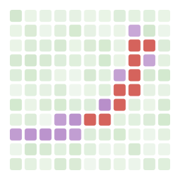

# GWData.jl


[](https://paulhopkins.github.io/GWData.jl/stable/)
[](https://paulhopkins.github.io/GWData.jl/dev/)
[](https://github.com/paulhopkins/GWData.jl/actions/workflows/CI.yml?query=branch%3Amain)
[](https://codecov.io/gh/paulhopkins/GWData.jl)
[](https://github.com/JuliaTesting/Aqua.jl)

A Julia toolkit for gravitational-wave detector data: loading, conditioning, and
time-frequency analysis of strain time series, built on `DSP.jl` and `FFTW.jl`.

## Features

- **Data types**: `TimeSeries`, `FrequencySeries`, and `Spectrogram`, anchored to GPS time,
  with `crop`, grid-checked arithmetic, and optional `Plots.jl` recipes.
- **I/O**: GWOSC HDF5 strain files, native IGWD frame (`.gwf`) files, and on-demand download
  of public strain data from [GWOSC](https://gwosc.org) by event name or GPS interval.
- **Spectral estimation**: median/mean-Welch PSD and ASD, cross-spectral density, and
  coherence.
- **Signal processing**: Butterworth band/high/low-pass and notch filters, whitening by
  inverse spectrum truncation, and polyphase resampling.
- **Time-frequency**: STFT spectrograms and a constant-Q transform with peak read-out.
- **Time and segments**: leap-second-aware GPS/UTC conversion and half-open
  `Segment`/`SegmentList` algebra.
- **Detectors**: H1/L1/V1 geometry, Greenwich mean sidereal time, antenna response, and
  arrival-time delay from geocenter.
- **Reference curves**: aLIGO and Advanced Virgo design-sensitivity PSD/ASD.
- **Posterior samples**: download and read the published GWTC-2.1/GWTC-3 parameter-estimation
  releases for an event (`fetch_posterior_samples`, `load_posterior_samples`).

## Installation

```julia
using Pkg
Pkg.add(url="https://github.com/paulhopkins/GWData.jl")
```

## Example

```julia
using GWData

path = fetch_open_data("H1", 1126256640, 1126256640 + 4096)   # GW150914 segment, cached
strain, dq_mask = load_gwosc_strain(path)

strain_asd = asd(strain; seglen=4 * 4096)                     # 4 s median-Welch segments
white = bandpass(whiten(strain, strain_asd; highpass=20.0), 30.0, 400.0)

seg = crop(strain, 1126259454.4, 1126259470.4)                # 16 s around the merger
scan, peak = q_transform(seg; frange=(20.0, 500.0))
peak.time, peak.frequency, peak.snr
```

## Documentation

The [documentation](https://paulhopkins.github.io/GWData.jl/dev/) has a tutorial for each
module, ending in a reproduction of the GW150914 discovery figure. It also has a
[conventions page](docs/CONVENTIONS.md) covering normalization and timing conventions,
and the full API reference. To build it locally, run `julia --project=docs docs/make.jl`.

Each tutorial is also available as a Jupyter notebook under [`notebooks/`](notebooks/),
alongside interactive explorers for the Q-transform and filter design in both
[`Pluto.jl`](notebooks/pluto/) and [`Bonito.jl`](notebooks/bonito/) form; see the
[notebooks README](notebooks/README.md) for how to run them.

## Data cache

Downloaded files are kept as plain files under their upstream names in `~/.cache/gwdata/` (GWOSC
strain in `strain/`, posterior-sample releases in `posteriors/`). Set `GWDATA_CACHE_DIR` to put the
cache elsewhere; otherwise `$XDG_CACHE_HOME/gwdata` is used when `XDG_CACHE_HOME` is set.
`gwdata_cache_dir()` returns the resolved path.

## Validation

Spectral estimation, filtering, whitening, resampling, spectrograms, coherence and the
Q-transform are numerically cross-checked against `gwpy`/`scipy`. Sidereal time, antenna
response, time delays and reference curves are checked against LALSuite. The measured
agreement is listed in the conventions page, and the comparison scripts are in
[`examples/validation/`](examples/validation/).
